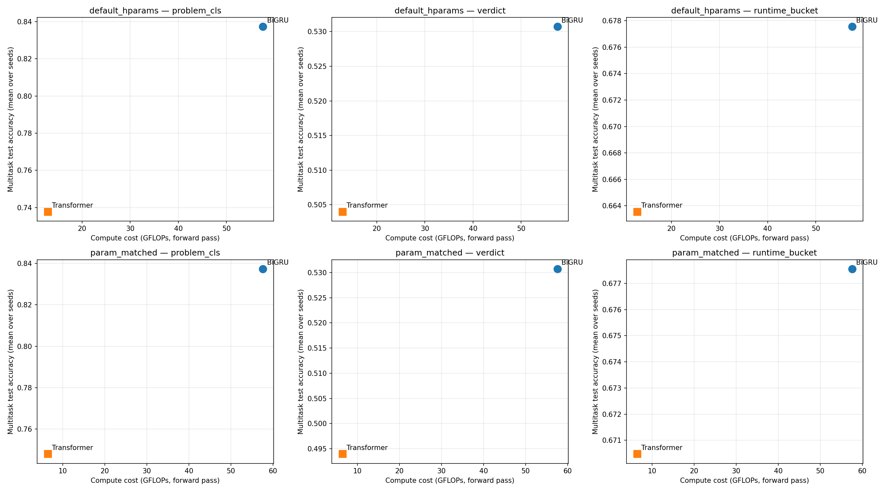
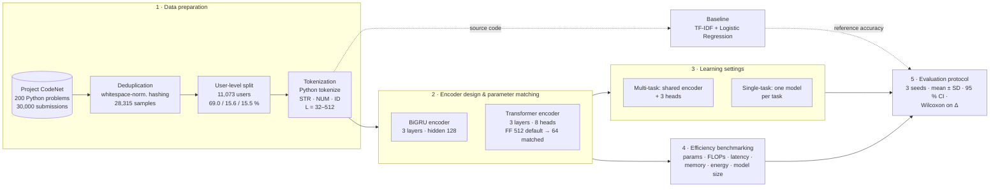
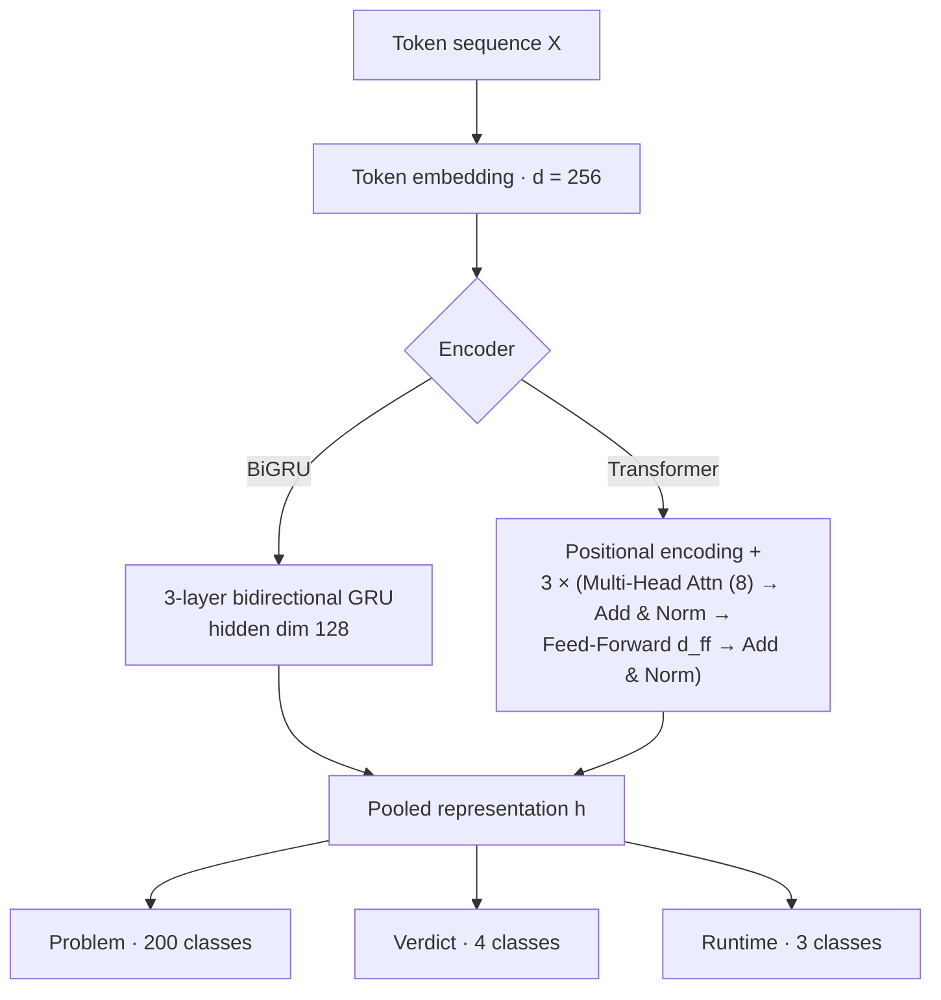
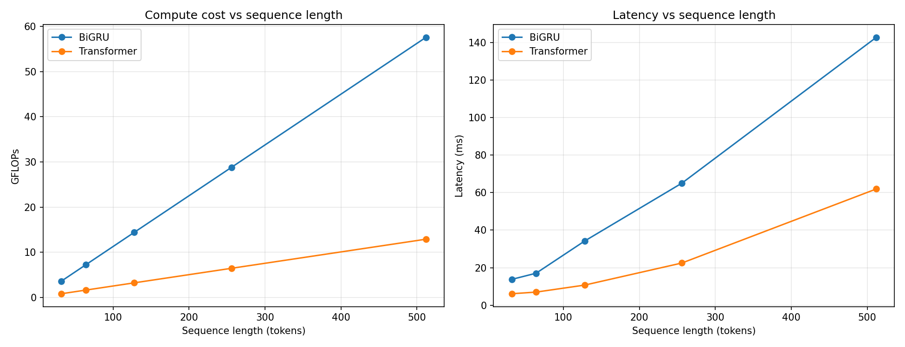

# Accuracy at a Cost: Efficiency–Performance Trade-offs in Recurrent and Attention-Based Code Models

**Muhammad Jawad Arshad, Anoop Yadav, Timur Jaganov, Yutaka Watanobe** — University of Aizu

[](paper/accuracy-at-a-cost.pdf)
[](LICENSE)

This repository contains the code, results and figures for the paper
[*Accuracy at a Cost*](paper/accuracy-at-a-cost.pdf). The paper is a controlled empirical study of
**Bidirectional GRU (BiGRU)** and **Transformer** encoders for source code. Both are trained in
**single-task** and **multi-task** settings, under **default** and **parameter-matched** configurations,
on a subset of Project CodeNet. Each model is evaluated on predictive accuracy and on computational
cost: parameters, FLOPs, inference latency, peak GPU memory and estimated GPU energy.

> **Main finding.** There is a clear accuracy–efficiency trade-off. BiGRU is more accurate. The
> Transformer needs substantially fewer FLOPs, has lower inference latency and uses less estimated
> GPU energy, but it uses substantially more peak GPU memory.

<p align="center">
  
</p>

---

## Contents

- [Research question and contributions](#research-question-and-contributions)
- [Dataset and tasks](#dataset-and-tasks)
- [Method](#method)
- [Results](#results)
- [Repository structure](#repository-structure)
- [Getting started](#getting-started)
- [Outputs](#outputs)
- [Limitations](#limitations)
- [Future work](#future-work)
- [Citation](#citation)

---

## Research question and contributions

> *How do recurrent and attention-based code encoders trade off predictive performance and computational
> efficiency under controlled model capacity, and how do multi-task learning and sequence length affect
> this trade-off?*

1. **Controlled accuracy–efficiency characterization.** BiGRU and Transformer encoders are compared on
   both accuracy and computational cost, not on accuracy alone.
2. **Parameter-matched evaluation.** A capacity-controlled configuration is compared with the default
   hyperparameters, to reduce the effect of differences in model size.
3. **Multi-seed evaluation.** Every experimental condition is run with three random seeds.
4. **Comprehensive efficiency analysis.** Parameters, FLOPs, inference latency, peak memory and GPU energy
   are reported in one framework.
5. **Sequence-length scalability analysis.** Accuracy and cost are measured at 32, 64, 128, 256 and 512 tokens.

---

## Dataset and tasks

Data comes from **[IBM Project CodeNet](https://github.com/IBM/Project_CodeNet)**. The dataset is **not**
included in this repository; download it separately.

| Metric | Value |
|---|---|
| Language | Python |
| Selected problems | 200 (those with the most submissions) |
| Initial submissions | 30,000 (up to 150 per problem) |
| Final samples | 28,315 (after near-duplicate removal) |
| Distinct users | 11,073 |
| Train / Val / Test split (user-level) | 69.0 / 15.6 / 15.5 % |

Code is tokenized with Python's `tokenize` module. String and numeric literals become `<STR>` and
`<NUM>`, identifiers become `<ID>`, and comments and indentation tokens are discarded. Splitting is done
by **user**, so all submissions from one user fall into a single partition.

| Task | Classes |
|------|---------|
| Problem classification | 200 |
| Verdict prediction | 4 — Accepted, Wrong Answer, Runtime Error, Time Limit Exceeded |
| Runtime bucket | 3 |

---

## Method

### Framework overview



### Encoders and parameter matching

Both encoders use the same 256-d token embedding, masked mean pooling and task heads, so only the
encoder body differs.



| Hyperparameter | BiGRU (default) | Transformer (default) | BiGRU (matched) | Transformer (matched) |
|---|:-:|:-:|:-:|:-:|
| Embedding dimension | 256 | 256 | 256 | 256 |
| Layers | 3 | 3 | 3 | 3 |
| Hidden / FF dimension | 128 | 512 | 128 | 64 |
| Attention heads | — | 8 | — | 8 |
| Dropout | 0.1 | 0.1 | 0.1 | 0.1 |

The Transformer feed-forward dimension is chosen by grid search so that the encoder-body parameter counts
match: **927,488 (BiGRU)** vs **929,984 (Transformer)**, within about 0.28 %. Task-specific output heads are
excluded from matching because their size depends on the number of classes. The matched Transformer is
therefore a *capacity-controlled* configuration, not an optimized one.

### Multi-task learning

Given an input X, the shared encoder produces a pooled representation **h**, and each task *k* has a
linear head **ŷₖ = Wₖh + bₖ**. The multi-task loss is the unweighted sum of the three cross-entropy losses:

**L<sub>total</sub> = L<sub>problem</sub> + L<sub>verdict</sub> + L<sub>runtime</sub>**

Transfer is measured as **Δ = Accuracy<sub>MT</sub> − Accuracy<sub>ST</sub>**, where a positive Δ means
joint training helped.

### Experimental design

| Experiment | Setting | Objective |
|---|---|---|
| Baseline | TF-IDF + LR | Lightweight non-neural reference |
| Architecture | ST | Compare BiGRU and Transformer predictive performance |
| Multi-task | MT | Measure task transfer using Δ |
| Parameter matching | Matched | Control for differences in encoder capacity |
| Efficiency | 512 tokens | Compare FLOPs, latency, memory and energy |
| Sequence scaling | 32–512 tokens | Examine accuracy and computational scaling |

**Training:** batch size 64, at most 15 epochs, early stopping on validation loss (patience 5) with the
best checkpoint restored, learning rate 3 × 10⁻⁴, 3 random seeds.
**Efficiency profiling:** FLOPs from module-level forward hooks; latency over 20 timed runs after 5
warm-up runs; GPU power from NVML.
**Hardware:** PyTorch 2.11 on an NVIDIA GeForce RTX 2060 (6 GB).

---

## Results

### Baseline (TF-IDF + Logistic Regression)

| Task | Accuracy |
|---|---:|
| Problem classification | 0.6355 |
| Verdict prediction | 0.5223 |
| Runtime bucket | 0.5618 |

### Single-task vs. multi-task accuracy (mean of 3 seeds)

| Task | Setting | BiGRU Default | BiGRU Matched | Transformer Default | Transformer Matched |
|---|---|---:|---:|---:|---:|
| Problem | ST | 0.8546 | 0.8546 | 0.7659 | 0.7540 |
|  | MT | 0.8373 | 0.8373 | 0.7377 | 0.7480 |
|  | **Δ** | −0.0173 | −0.0173 | −0.0282 | −0.0060 |
| Runtime | ST | 0.6664 | 0.6664 | 0.6508 | 0.6537 |
|  | MT | 0.6776 | 0.6776 | 0.6635 | 0.6705 |
|  | **Δ** | +0.0111 | +0.0111 | +0.0128 | +0.0167 |
| Verdict | ST | 0.5082 | 0.5082 | 0.4646 | 0.4751 |
|  | MT | 0.5307 | 0.5307 | 0.5040 | 0.4939 |
|  | **Δ** | +0.0225 | +0.0225 | +0.0394 | +0.0189 |

- BiGRU is more accurate than the Transformer on all three tasks. The largest gap is on problem
  classification: 0.8546 vs. 0.7659, **+8.87 percentage points**.
- Multi-task learning has **task-dependent** effects. It improves verdict and runtime prediction but
  causes **negative transfer** on the 200-class problem-classification task.
- Parameter matching reduces the Transformer's negative transfer on problem classification from
  −2.82 % to −0.60 %. BiGRU is the fixed reference, so its results do not change between configurations.

### Efficiency at sequence length 512

| Architecture | Config | Params (M) | FLOPs (G) | Latency (ms) | Memory (MB) | Energy (mJ) |
|---|---|---:|---:|---:|---:|---:|
| BiGRU | Default | 0.981 | 57.552 | 113.60 | 359.45 | 7752.16 |
| BiGRU | Matched | 0.981 | 57.580 | 106.60 | 367.88 | 7435.50 |
| Transformer | Default | 1.082 | 12.892 | 61.95 | 1238.13 | 5298.75 |
| Transformer | Matched | 0.984 | 6.449 | 64.33 | 1248.01 | 5370.94 |

- **Default:** the Transformer needs **77.6 % fewer FLOPs** than BiGRU, with lower latency and energy, but about
  **3.4× the peak GPU memory**.
- **Parameter-matched:** the Transformer's FLOPs drop further, to **88.8 % fewer** than BiGRU, at an almost
  identical parameter count.
- **Efficiency is multidimensional.** The Transformer wins on FLOPs, latency and energy; BiGRU wins on peak
  memory. Neither dominates on every dimension.

**Which to choose:** BiGRU when predictive accuracy or peak memory matters most. Transformer when compute,
latency or energy is the main constraint.

### Sequence-length scaling (multi-task)

<p align="center">
  
</p>

| Seq. length | BiGRU acc. | Transformer acc. | BiGRU GFLOPs | Transformer GFLOPs | Acc. gap |
|---:|---:|---:|---:|---:|---:|
| 32 | 0.443 | 0.429 | 3.61 | 0.81 | 0.014 |
| 64 | 0.581 | 0.542 | 7.21 | 1.62 | 0.039 |
| 128 | 0.632 | 0.596 | 14.42 | 3.23 | 0.036 |
| 256 | 0.645 | 0.613 | 28.81 | 6.45 | 0.032 |
| 512 | 0.650 | 0.620 | 57.60 | 12.89 | 0.030 |

Both architectures gain from longer inputs, but the gains shrink at longer lengths while compute keeps
growing. BiGRU is more accurate at every length. The Transformer stays substantially cheaper throughout.
Sequence length is therefore a trade-off in its own right, not a setting with one best value.

<sub>The sequence-length experiment profiled each length in a separate run, so its 512-token latency and
energy differ from the main efficiency table above. That table is the primary reference.</sub>

---

## Repository structure

```
accuracy-at-a-cost/
├── paper/
│   └── accuracy-at-a-cost.pdf                     # the paper
├── notebooks/
│   └── codenet_multitask_efficiency_study.ipynb   # full experimental pipeline
├── results/
│   ├── tables/            # CSV outputs of the reported run
│   ├── figures/           # trade-off, sequence-length and baseline plots
│   └── run_manifest.json  # library versions, hardware, configuration, seeds
├── pilot/                 # earlier small-scale pilot scripts (kept for reference)
│   └── README.md
├── requirements.txt
├── LICENSE
└── README.md
```

---

## Getting started

### 1. Install

```bash
git clone https://github.com/jawad123arshad/accuracy-at-a-cost.git
cd accuracy-at-a-cost
python -m venv .venv
# Windows: .venv\Scripts\activate    |   Linux/macOS: source .venv/bin/activate

# Install the PyTorch build matching your CUDA driver first: https://pytorch.org/get-started/locally/
pip install torch --index-url https://download.pytorch.org/whl/cu128
pip install -r requirements.txt
```

### 2. Get the data

Download and extract Project CodeNet ([instructions](https://github.com/IBM/Project_CodeNet#dataset-download)).
Then point the notebook at the folder that contains `metadata/` and `data/`:

```bash
# Windows (PowerShell)
$env:CODENET_PATH = "D:\datasets\Project_CodeNet"
# Linux/macOS
export CODENET_PATH=/data/Project_CodeNet
```

### 3. Run

```bash
jupyter lab notebooks/codenet_multitask_efficiency_study.ipynb
```

Run the cells from top to bottom. The full study takes roughly a day on an RTX 2060. To check that the
pipeline works before a full run, first reduce `CONFIG` in Section 0:

```python
n_problems=20, n_seeds=1, model_seeds=[1], comparison_modes=["default_hparams"], seq_len_n_seeds=1
```

---

## Outputs

The notebook writes these files next to itself. Copies from the reported run are in [`results/`](results/).

| File | Contents |
|---|---|
| `c1_raw_runs.csv` | Every training run: architecture, configuration, seed, setting, task, accuracy, time, energy |
| `c1_aggregated.csv` | Seed-aggregated single-task vs. multi-task accuracy and Δ with 95 % CI |
| `baseline_results.csv` | TF-IDF + Logistic Regression baseline |
| `efficiency_profile.csv` / `profiling_results.csv` | Params, FLOPs, latency, memory and energy per architecture |
| `pareto_results.csv` | Accuracy vs. GFLOPs per task |
| `sequence_length_scaling.csv` | Accuracy and cost for sequence lengths 32–512 |
| `run_manifest.json` | Reproducibility manifest |

---

## Limitations

- **Dataset scope.** Only Python submissions to the 200 most-submitted CodeNet problems are used. The
  findings may not transfer to other languages, to problems with fewer submissions, or to code outside
  competitive programming.
- **Parameter matching is a partial control.** It matches total encoder-body size, not how capacity is
  distributed. The matched Transformer's small feed-forward dimension (64) may limit its accuracy.
- **Task-label noise.** Verdict and runtime labels depend partly on test cases, the execution environment
  and hardware, none of which appear in the source code.
- **Energy is an estimate.** It is computed from NVML power readings and elapsed time, so it can miss
  short-term power fluctuations.
- **Statistical power.** Three seeds per condition give a limited view of variability. Treat Wilcoxon
  p-values as exploratory.

## Future work

- Scale the evaluation to the full Project CodeNet dataset.
- Add state-space models (e.g. **Mamba**) alongside BiGRU and Transformer.
- Explore adaptive loss weighting and task-balancing strategies to reduce negative transfer on problem
  classification.

---

## Citation

If you use this code, please cite:

```bibtex
@misc{arshad2026accuracy,
  title  = {Accuracy at a Cost: Efficiency--Performance Trade-offs in
            Recurrent and Attention-Based Code Models},
  author = {Arshad, Muhammad Jawad and Yadav, Anoop and Jaganov, Timur and Watanobe, Yutaka},
  year   = {2026},
  url    = {https://github.com/jawad123arshad/accuracy-at-a-cost}
}
```

## License

Code is released under the [MIT License](LICENSE). The paper PDF is © the authors.

Project CodeNet: Puri et al., *CodeNet: A Large-Scale AI for Code Dataset for Learning a Diversity of Coding
Tasks*, 2021.
